<p align="center">
  
</p>

<p align="center">
  
  
  
  
</p>

<p align="center">
  <a href="#about">About</a> &nbsp;|&nbsp;
  <a href="#objectives">Objectives</a> &nbsp;|&nbsp;
  <a href="#curriculum">Curriculum</a> &nbsp;|&nbsp;
  <a href="#progress-notes--technical-deep-dives">Progress Notes</a> &nbsp;|&nbsp;
  <a href="#capstone-project--redis-compatible-key-value-server">Capstone</a> &nbsp;|&nbsp;
  <a href="#setup">Setup</a>
</p>

---

## About

| | |
| --- | --- |
| **Author** | Dhiraj Shrestha |
| **Institution** | Institute of Engineering, Pulchowk Campus (IOE), Nepal |
| **Prior Experience** | C/C++, Python, FastAPI, PostgreSQL, Redis, Linux, Git, Networking |
| **Engineering Focus** | Backend systems, distributed systems, network programming |

This repository documents a structured 15-day intensive study of the Rust programming language, progressing from fundamentals to a production-grade capstone project. The approach follows professional mentorship methodology: every concept is taught with its motivation, mental model, industry usage, and common failure modes.

---

## Objectives

- Develop the ability to read, write, review, and ship idiomatic Rust in a professional setting
- Build a deep understanding of why Rust's ownership, type, and concurrency models work the way they do
- Complete a Redis-compatible in-memory key-value server as the capstone project
- Reach independent learning capability by Day 15

---

## Curriculum

<p align="center">
  
</p>

| Day | Topic | Status |
| --- | --- | --- |
| 01 | Toolchain setup, types, variables, mutability, control flow, functions, modules |  |
| 02 | Ownership, moves, borrowing, references, slices, Copy vs Drop, RAII, NLL |  |
| 03 | Structs (Named, Tuple, Unit-like), Debug/Display traits, Methods, Associated Functions, Enums, Pattern Matching |  |
| 04 | Collections, String vs &str, iterators, closures, adapters |  |
| 05 | Traits, generics, trait objects, static vs dynamic dispatch, lifetimes |  |
| 06 | Modules, crates, workspaces, testing, documentation, semver |  |
| 07 | Smart pointers, interior mutability, professional error handling, CLI project |  |
| 08 | Concurrency: threads, channels, Arc/Mutex, atomics, rayon |  |
| 09 | Async Rust: futures, async/await, tokio internals — Capstone begins |  |
| 10 | Networking with tokio: TCP, framing, protocol parsing, backpressure |  |
| 11 | serde, axum, sqlx with PostgreSQL, configuration management |  |
| 12 | Observability: tracing, structured logging, graceful shutdown, benchmarking |  |
| 13 | Unsafe Rust, FFI with C, macros, performance tuning, memory layout |  |
| 14 | CI/CD, property testing, fuzzing, release profiles, API design patterns |  |
| 15 | Capstone finalization, benchmarks, code review, 3-month learning roadmap |  |

---

## Progress Notes & Technical Deep Dives

### Day 02–03 Milestones Covered

Expand any milestone to read the notes.

<p align="center">
  
</p>

<details open>
<summary><b>Ownership & Borrowing</b></summary>
<br>

Mastered partial moves in structs (tracking ownership down to individual fields) and borrowing rules (`&self` vs `&mut self`).

</details>

<details>
<summary><b>Struct Variants</b></summary>
<br>

Explored classic named-field structs, lightweight **tuple structs** for domain type safety, and zero-sized **unit-like structs** for trait anchoring and compile-time marker types.

</details>

<details>
<summary><b>Formatting Traits & Macros</b></summary>
<br>

Implemented `#[derive(Debug)]` for `{:#?}` multi-line inspection, understood `std::fmt::Display` for user-facing output, and utilized the `dbg!` macro (prints expression + line number to `stderr` while returning ownership).

</details>

<details>
<summary><b>Methods & Ergonomics</b></summary>
<br>

Defined `impl` blocks using dot syntax and leveraged Rust's **automatic referencing and dereferencing** mechanism.

</details>

<details>
<summary><b>Associated Functions</b></summary>
<br>

Implemented constructor patterns (`Type::new()`) and factory functions (`Type::square()`) using double-colon (`::`) namespace invocation.

</details>

<details>
<summary><b>Enums & <code>Option&lt;T&gt;</code></b></summary>
<br>

Modeled algebraic data types with variant payloads and eliminated null-pointer failures using Rust's `Option<T>` (`Some(T)` / `None`).

</details>

<details>
<summary><b>Pattern Matching & Control Flow</b></summary>
<br>

Mastered `match` exhaustiveness checks, payload extraction/binding, catch-all wildcards (`_`) vs. named catch-all variables, the unit type (`()`), and concise syntactic sugar with `if let` and `let...else` (diverging early exits to stay on the "Happy Path").

</details>

---

## Capstone Project — Redis-Compatible Key-Value Server

<p align="center">
  
</p>

An async, Redis-compatible in-memory key-value server built incrementally from Day 9 onwards.

**Planned features:**

- Async TCP server on tokio implementing the RESP protocol, compatible with `redis-cli`
- Supported commands: `GET`, `SET` (with `EX`/`PX`), `DEL`, `EXISTS`, `INCR`, `EXPIRE`, `TTL`, `PING`, `PUBLISH/SUBSCRIBE`
- Concurrent, sharded in-memory store with TTL expiry
- Persistence via append-only file with crash recovery on startup
- Structured logging with `tracing`, signal handling, and graceful shutdown
- Unit, integration, and property-based tests
- Criterion benchmarks with comparison against real Redis
- GitHub Actions CI pipeline and full documentation

---

## Setup

```bash
# Install Rust
curl --proto '=https' --tlsv1.2 -sSf https://sh.rustup.rs | sh

# Check for errors (fast — use after every change)
cargo check

# Run
cargo run

# Lint
cargo clippy -- -D warnings

# Format
cargo fmt

# Test
cargo test
```
